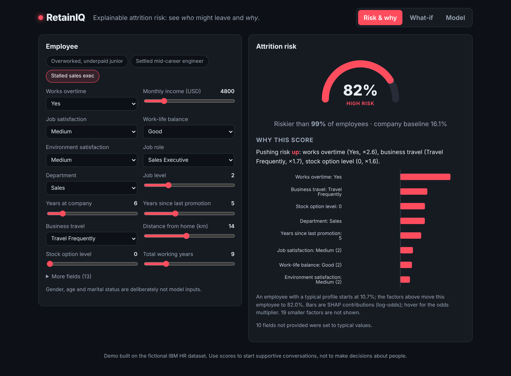
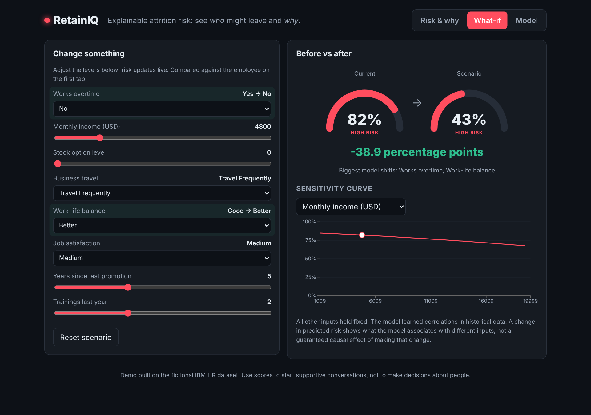
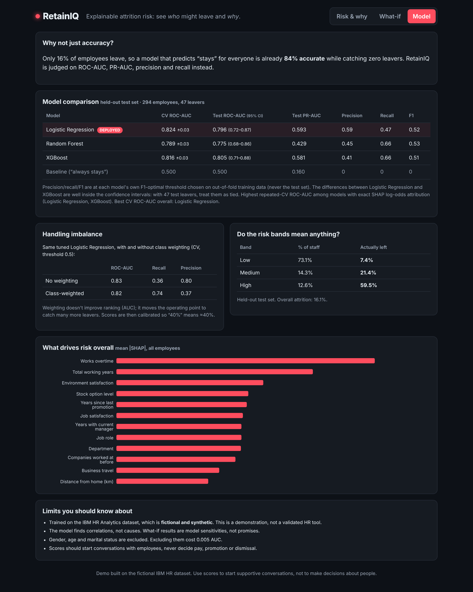
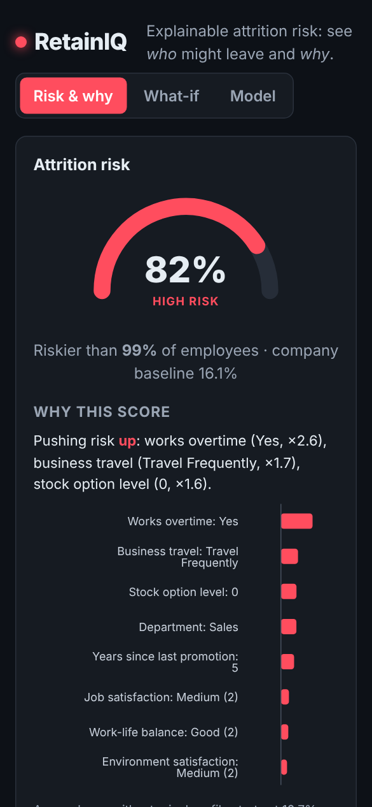
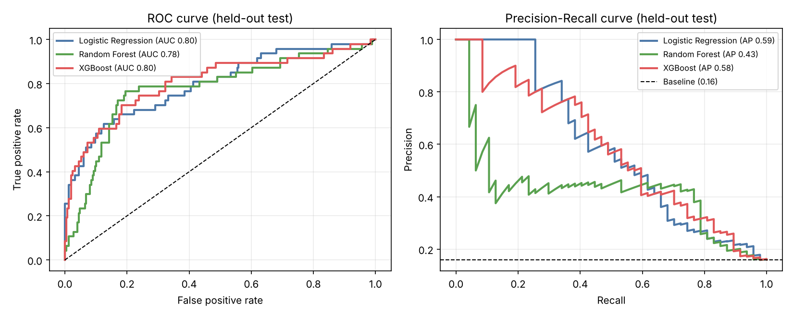
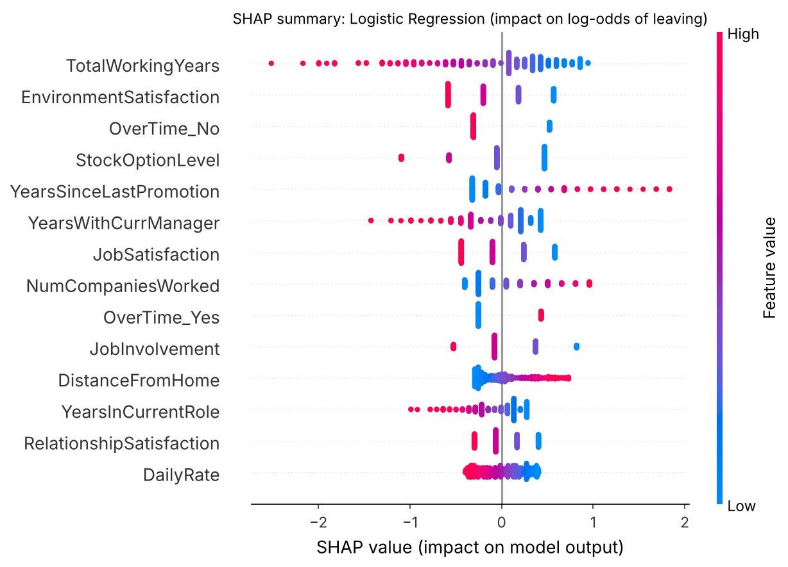

# 🔴 RetainIQ: explainable employee attrition risk

> Know **who** might leave and **why**, with honest evaluation instead of a lone accuracy number.

<p align="center">
  <a href="https://retain-iq-delta.vercel.app"></a>
  <a href="https://retainiq-backend-gmqx.onrender.com"></a>
  <a href="https://retainiq-backend-gmqx.onrender.com/model-card"></a>
</p>

| | Link |
|---|---|
| **Frontend (UI)** | https://retain-iq-delta.vercel.app |
| **Backend (API)** | https://retainiq-backend-gmqx.onrender.com |
| **API health check** | https://retainiq-backend-gmqx.onrender.com/health |

> ⏳ The API runs on Render's free tier and sleeps when idle. The first visit can take about 30 seconds to wake up; after that it's fast.

React + Flask + scikit-learn + SHAP · Dockerised · CI-tested

| Risk & SHAP drivers | What-if lab |
|---|---|
|  |  |

| Model card | Mobile |
|---|---|
|  |  |

## What it does

1. **Explains every score with SHAP.** HR sees the factors pushing risk up or down (e.g. *Works overtime: Yes → ×2.6 odds*), not just a number. One-hot columns are grouped back into readable features, and contributions add up exactly to the displayed risk (enforced by a test).
2. **Evaluates properly for imbalanced data.** Only 16% of employees leave, so "always stays" is already 84% accurate. Models are judged on ROC-AUC, PR-AUC, precision and recall, with bootstrap confidence intervals on a held-out test set.
3. **Compares Logistic Regression, Random Forest and XGBoost** under identical preprocessing and tuning.
4. **What-if tool.** Change overtime, income, stock options, travel, work-life balance… and watch risk move, plus a sensitivity curve.
5. **Ships.** Docker, docker-compose, CI, a Render blueprint and a Vercel-ready frontend.

## Dataset note

> This is IBM's fictional HR Analytics dataset (1,470 employees). Results describe this data, not real companies, and show associations, not causes.

## Results

Dataset: IBM HR Analytics (1,470 employees, 16.1% attrition). Stratified 80/20 split; hyper-parameters tuned by randomized search on the training split only; the test set (294 employees, 47 leavers) is used once for reporting.

| Model | CV ROC-AUC | Test ROC-AUC (95% CI) | Test PR-AUC | Precision | Recall | F1 |
|---|---|---|---|---|---|---|
| Logistic Regression **(deployed)** | 0.824 ± 0.03 | 0.796 (0.72–0.87) | 0.593 | 0.59 | 0.47 | 0.52 |
| Random Forest | 0.789 ± 0.03 | 0.775 (0.68–0.86) | 0.429 | 0.45 | 0.66 | 0.53 |
| XGBoost | 0.816 ± 0.03 | 0.805 (0.71–0.88) | 0.581 | 0.41 | 0.66 | 0.51 |
| Baseline "always stays" | 0.500 | 0.500 | 0.160 | 0 | 0 | 0 |

Precision/recall/F1 use each model's F1-optimal threshold, chosen on out-of-fold *training* predictions.



**Honest reading**

- Logistic Regression and XGBoost are **statistically tied**: their confidence intervals overlap heavily with only 47 test leavers. Logistic Regression was deployed because it had the best cross-validated AUC and gives exact SHAP attributions. Random Forest, the original model, is the weakest.
- **Imbalance:** class weighting did not improve ranking (CV AUC 0.82 vs 0.83 unweighted) but moved the operating point: recall at threshold 0.5 rises from 0.36 to 0.74 (precision falls from 0.80 to 0.37). Weighting inflates probabilities, so scores are **calibrated** (Platt scaling on out-of-fold predictions): Brier 0.159 → 0.099; mean predicted 15.1% vs observed 16.0%.
- **Risk bands mean something** (held-out test set):

| Band | % of staff | Actually left |
|---|---|---|
| Low | 73.1% | 7.4% |
| Medium | 14.3% | 21.4% |
| High | 12.6% | 59.5% |

- **Salary is a weak lever in this data**; overtime is a strong one. Income is largely explained by job level and tenure, so the what-if tool shows only a small drop from a raise. That is the model's finding, not a bug.
- **Protected attributes are excluded** (gender, age, marital status). Excluding them cost 0.005 CV AUC.



## Explainability (SHAP)

`backend/explain.py` uses SHAP's exact `LinearExplainer`/`TreeExplainer` (fast enough for live requests). Contributions are in calibrated log-odds, so `base + Σ contributions = final risk`. Each driver also carries `odds_multiplier = exp(contribution)`.

```json
{"risk_score": 82.0, "risk_level": "High",
 "explanation": {"base_risk": 10.72, "final_risk": 82.01,
   "drivers": [{"label": "Works overtime", "value": "Yes", "odds_multiplier": 2.6, "direction": "increases"}]}}
```

## What-if

```bash
curl -X POST localhost:8000/whatif -H 'Content-Type: application/json' \
  -d '{"employee": {"OverTime": "Yes", "MonthlyIncome": 4800}, "changes": {"OverTime": "No"}}'
```

Returns baseline vs scenario risk, the change in percentage points, and which features' contributions shifted. **Caveat:** the model learns correlations; a what-if shows model sensitivity, not a guaranteed causal effect.

## API

| Endpoint | Purpose |
|---|---|
| `GET /health`, `GET /` | liveness / info |
| `GET /schema` | form definition (fields, ranges, labels) |
| `GET /personas` | demo employees |
| `GET /model-card` | metrics, comparison, global SHAP |
| `POST /predict` | risk + SHAP drivers. Missing fields are filled with training medians and reported in `assumed_defaults`; out-of-range values are clipped and reported in `clipped_inputs` |
| `POST /whatif` | `{"employee": {...}, "changes": {...}}` |
| `POST /sweep` | risk curve over one feature |

Invalid input returns HTTP 422 with a message. The old v1 payload (`OverTime_Yes`) still works.

## Run it

**Docker (recommended)**

```bash
docker compose up --build      # UI http://localhost:8080 · API http://localhost:8000
```

**Without Docker**

```bash
pip install -r backend/requirements.txt && cd backend && python app.py   # API on :5000
cd frontend && npm ci && npm run dev                                      # UI on :5173 (proxies /api)
```

**Retrain** (downloads a public copy of the dataset on first run, about 3 min on 1 CPU):

```bash
pip install -r model/requirements.txt && python model/train.py
```

**Test:** `cd backend && python -m pytest ../tests` and `cd frontend && npm run lint && npm run build`.

## Deploy

- **API → Render** (live at https://retainiq-backend-gmqx.onrender.com): New → Blueprint → select this repo (uses `render.yaml`, Docker). Free tier sleeps when idle; the UI retries while it wakes.
- **UI → Vercel:** root directory `frontend`, env var `VITE_API_URL=https://<your-service>.onrender.com`. Then set `ALLOWED_ORIGINS` on Render to your Vercel domain.

## Project layout

```
backend/    Flask API, config, SHAP, predictor, artifacts/ (model, metrics, SHAP background)
model/      train.py (tune, compare, calibrate, export)  · original notebook
frontend/   React + Vite + Recharts · Dockerfile + nginx.conf
tests/      API tests (SHAP additivity, what-if, validation, fairness)
docs/img/   screenshots and figures
```

## Limitations

- The IBM dataset is **fictional and synthetic**. This is a demonstration, not a validated HR tool.
- Correlation, not causation. Scores should start supportive conversations, never decide pay, promotion or dismissal.
- Small test set (47 leavers): treat small metric differences as noise.

## Changes from v1

The deployed model was a Random Forest while the README described Logistic Regression; the pickle's scikit-learn version differed from the pinned one; the API padded 132 of 135 columns with zeros; the UI sent a hardcoded, out-of-range income; ROC-AUC was computed on hard labels. All fixed: one raw-feature pipeline, pinned versions, validated input, a real form.

## Author

Built by [Keerthana](https://github.com/keerthana911-netizen). Data: IBM HR Analytics Employee Attrition & Performance (Kaggle, `pavansubhasht`).
